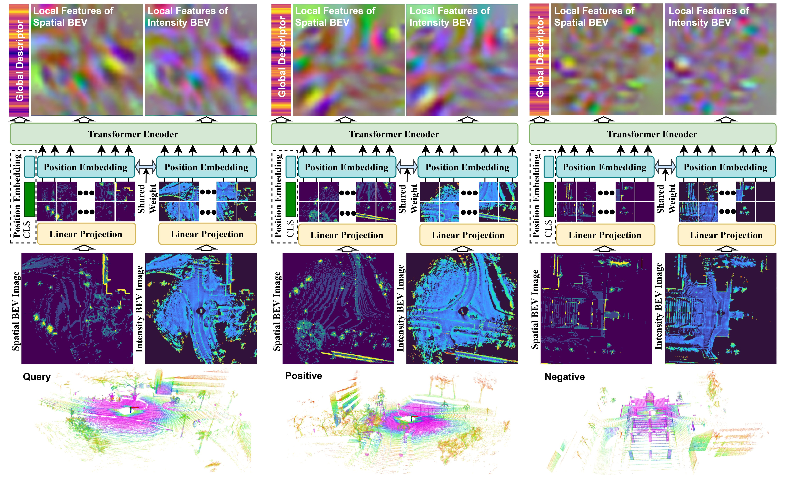
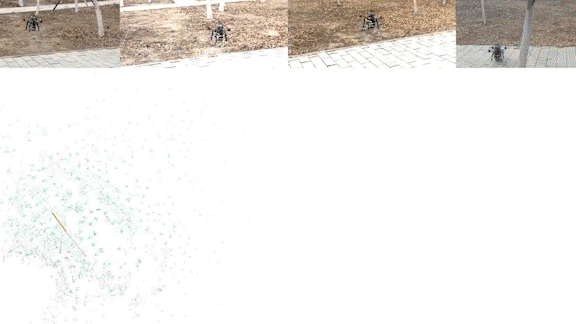

# UniLGL: Learning Uniform Place Recognition for FOV-limited/Panoramic LiDAR Global Localization

<p align="center">
<a href="https://ieeexplore.ieee.org/document/11429541"></a>
<a href="https://arxiv.org/abs/2507.12194"></a>
<a href="https://youtu.be/p8D-sxq8ygI"></a>
<a href="https://www.bilibili.com/video/BV1Yw81zCEUv/"></a>
</p>

<div align="center">
<a href="https://youtu.be/p8D-sxq8ygI" target="_blank"></a>
</div>

## Quick Start
The project was tested with Ubuntu 20.04 and Jetson Orin NX. We assume that you have already installed the necessary dependencies such as CUDA, ROS, and Conda.

**1. Clone the Code**
```
git clone https://github.com/shenhm516/UniLGL.git
```

**2. Create Virtual Environment**
```
conda create --name unilgl python=3.12
conda activate unilgl
pip install torch==2.9.1 torchvision==0.24.1 torchaudio==2.9.1 --index-url https://download.pytorch.org/whl/cu128
conda install -c pytorch -c nvidia -c conda-forge faiss-gpu=1.13.0
conda install -c conda-forge opencv
pip install matplotlib laspy lazrs scipy shapely tqdm h5py scikit-learn tensorboardX
#Install Patchwork++ in the conda environment. It is introduced to fit the ground plane when the LiDAR is not horizontally mounted (disabled by default).
git clone https://github.com/url-kaist/patchwork-plusplus.git 
cd patchwork-plusplus #Patchwork++ can be placed in any directory you prefer.
make pyinstall
```

**3. Build C++ Dependence**
```
sudo apt-get install libeigen3-dev libopenblas-dev liblapack-dev libtbb-dev
cd utils & pip install -e . & cd ..
```

**4. Dataset Preparation**

You can download the dataset from [NTU Data Repository](https://researchdata.ntu.edu.sg/privateurl.xhtml?token=2497d95a-6d75-420a-9820-9bec90ffa61a). The folder layout is given as follows:
```
UniLGL-Data/
├── MCD/
    ├──hull/
        ├──ntu_day_02.txt
        ├──...
        ├──ntu_night_13.txt
    ├──poses/
        ├──ntu_day_02.txt
        ├──...
        ├──ntu_night_13.txt
    ├──ntu_day_02
        ├──bev_imgs
        ├──intensity_imgs
        ├──laz
    ├──...
    ├──ntu_night_13
├── MCD-OS/
├── ...
├── GardenHusky/
```
If you only want to train UniLGL and evaluate it for place recognition (without pose estimation), we provide a minimal dataset (about 2.2G) without point clouds, named ```UniLGL-Mini-Data.zip``` in the [NTU Data Repository](https://researchdata.ntu.edu.sg/privateurl.xhtml?token=2497d95a-6d75-420a-9820-9bec90ffa61a).

To generate a dataset from your own data, we provide an example script (```dataset/gen_bev.sh```) for generating datasets from ROS bags.

Remark: You should set the path of dataset in ```train.py``` and ```eval.py``` before the training and evaluation.

**5. Train**

Download the DINO pre-trained weights (```dino_deitsmall8_pretrain.pth```) from the [NTU Data Repository](https://researchdata.ntu.edu.sg/privateurl.xhtml?token=2497d95a-6d75-420a-9820-9bec90ffa61a) and place it in the ```pretrain/``` directory.
```
mkdir pretrain
```
One-command training:
```
python train.py
```

**6. Evaluation**

If you prefer not to train the model, you can download our pre-trained weights (```checkpoint_epoch_19.pth.tar```) from the [NTU Data Repository](https://researchdata.ntu.edu.sg/privateurl.xhtml?token=2497d95a-6d75-420a-9820-9bec90ffa61a) and place it in the ```runs/UniLGL/``` directory.
```
mkdir -p runs/UniLGL
```
One-command evaluation:
```
python eval.py
```
## Applications
UniLGL has been deployed on diverse platforms, including full-size trucks and agile MAVs, to enable high-precision localization and mapping as well as multi-MAV collaborative exploration in port and forest environments, demonstrating the applicability of UniLGL in industrial and field scenarios.
<div align="center">


</div>

## ToDo
We will open-source a complete LiDAR-only SLAM system by integrating UniLGL with [CTE-MLO](https://github.com/shenhm516/CTE-MLO), which will be merged into the CTE-MLO repository.

## Acknowledgments
This project is developed based on [BEVPlace++](https://github.com/zjuluolun/BEVPlace2) and [DINO](https://github.com/facebookresearch/dino). Thanks for their excellent work!

## Additional Information
Citation: If you find this work useful or interesting, please kindly give us a star ⭐; If our repository supports your academic projects, please cite our paper. Thank you!

```bibtex
    @ARTICLE{11429541,
    author={Shen, Hongming and Chen, Xun and Hui, Yulin and Wu, Zhenyu and Wang, Wei and Lyu, Qiyang and Deng, Tianchen and Wang, Danwei},
    journal={IEEE Transactions on Robotics}, 
    title={UniLGL: Learning Uniform Place Recognition for FOV-limited/Panoramic LiDAR Global Localization}, 
    year={2026},
    pages={1-20},
    doi={10.1109/TRO.2026.3672514}}
```